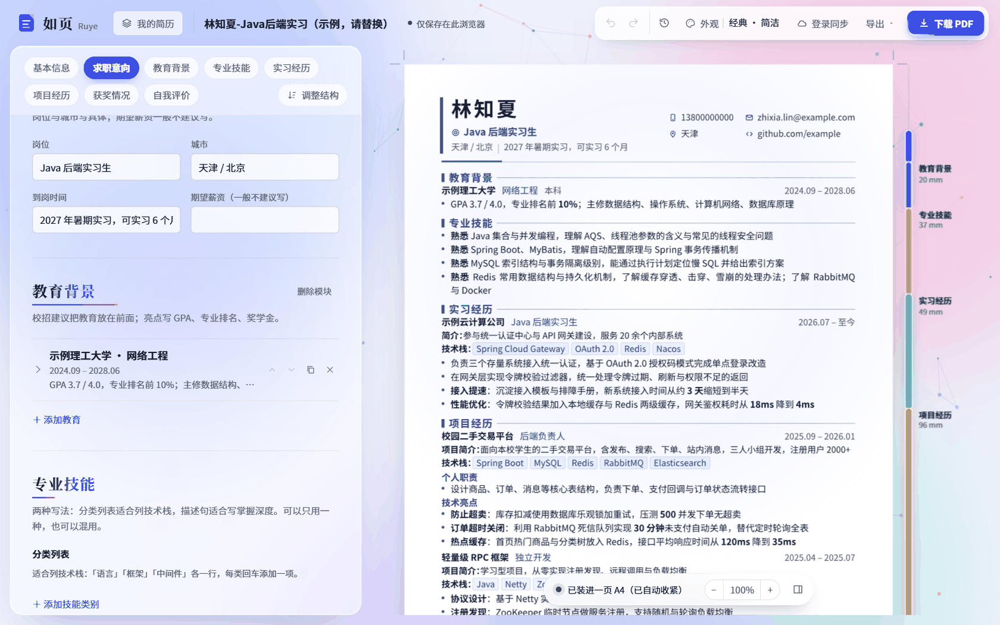

# 如页 Ruye

开源、本地优先的中文技术简历编辑器。预览用的就是导出 PDF 的那次排版，看到什么就导出什么。

[](https://github.com/a-xiaoyuan/ruye-resume/actions/workflows/ci.yml)
[](https://a-xiaoyuan.github.io/ruye-resume/)
[](LICENSE)

**在线使用：<https://a-xiaoyuan.github.io/ruye-resume/>**
无需注册。首次打开要下载约 34MB 的排版引擎和字体，之后由浏览器缓存。



## 特点

- **预览即导出**：预览和 PDF 都由浏览器里的 [Typst](https://typst.app) WASM 排版，用同一份输入、同一次排版结果，不存在网页和打印两套样式。
- **一页就是一页**：A4 智能一页在可读性底线内自动收紧；实在装不下就直接报错，说明超出多少毫米、哪个模块最占地方，不会偷偷缩小字号或多出一页。
- **本地优先**：简历保存在浏览器本地，PDF 在本地生成，断网也能用。需要多台电脑同步时，可以自己部署可选的同步后端。

## 页面模式

| 模式 | 说明 | 适合 |
|---|---|---|
| A4 智能一页 | 超出时依次收紧间距、版式、行距、字号；装不下时报错并给出溢出报告。内容偏少时适当放宽间距 | 打印、投递 |
| 无损长一页 | A4 宽、高度随内容变化的单页 PDF，不缩字号 | 邮件、网申附件 |
| 标准分页 | 普通 A4 分页，页脚印页码 | 打印 |

可读性底线：正文 ≥ 10.5pt，行距 ≥ 1.35，页边距 ≥ 12mm。溢出报告里每个模块的高度，是把它拿掉后重新排版实际量出来的。

## 模板

七套模板，六种主题色（海蓝、青碧、胭脂、紫藤、琥珀、石墨），换模板、换颜色都不用重填内容。

| 模板 | 风格 |
|---|---|
| 经典 · 简洁（默认） | 左边姓名与求职意向，右边联系方式，单一主色，适合大多数投递 |
| 极简 · 黑白 | 只用黑与深灰，适合黑白打印 |
| 雅致 · 衬线 | 宋体姓名居中，适合国企、银行、研究岗 |
| 时间轴 | 左侧时间列，经历按时间排列 |
| 校招 · 横幅 | 顶部渐变横幅，适合应届生、实习 |
| 社招 · 侧条 | 左缘色条、信息更密，适合 1～8 年经验 |
| 双栏 · 深色侧栏 | 左侧深色侧栏，两栏按实际高度自动平衡 |


## 编辑器

- **十一种模块**：基本信息（含照片）、求职意向、教育、工作、实习、项目、技能、科研、论文、获奖、自我评价，可排序、隐藏。
- **省事的表单**：日期点选年月，一键「至今」；城市、学历、到岗时间等常用值一点即填；技术栈按标签输入；粘贴带序号的段落会自动拆成多条要点；出生年月可显示为年龄。
- **模块高度标尺**：预览旁标出每个模块占多高，点击跳到对应模块。
- **写作建议**：提示缺联系方式、经历里没有数字、单条过长、只写了「负责 / 参与」等问题。
- **多份简历**：「我的简历」里新建、复制、重命名、删除；删除先进回收站，每份简历自动保存历史版本，可随时恢复。支持撤销 / 重做。
- **导入导出**：PDF（文字可选中、链接可点击、字体内嵌）、`.ruye.json`、Markdown，后两者可以互相转换。导出前会检查字体缺字。
- **按岗位的示例**：Java 后端、Go 后端、前端、测试开发、算法、产品经理六份虚构示例。

## 快速开始

需要 Node.js ≥ 22.18 和 pnpm 10。

```bash
pnpm install
pnpm fonts      # 首次运行：下载思源字体并生成子集，需要 pip install fonttools
pnpm dev        # http://localhost:5173
```

| 命令 | 作用 |
|---|---|
| `pnpm test` | 单元测试与 Typst 黄金测试（没有字体时跳过黄金测试并说明原因） |
| `pnpm typecheck` | 类型检查 |
| `pnpm e2e` | Playwright 端到端测试 |
| `pnpm build` | 构建静态站点到 `apps/web/dist` |

## 同步后端（可选）

`server/` 是 Java 17 + Spring Boot 3 的同步服务：注册登录、多份简历同步、云端历史版本。默认用 H2，也支持 MySQL。不登录时前端不会访问它。部署方式见 [server/README.md](server/README.md)。

本机始终是主副本。两台设备同时改了同一份简历时，两份都会保留；退出登录或注销账号都不会删除本机内容。

## 项目结构

```
apps/web/            React 编辑器
packages/schema/     文档类型、校验、Markdown 互转
packages/engine/     排版引擎：一页收紧、长一页、分页、溢出报告
packages/templates/  Typst 模板与排版参数
server/              可选的同步后端
fixtures/            虚构示例简历
tests/  e2e/         单元测试、端到端测试
```

## 许可证

代码使用 [MIT](LICENSE)。字体为思源黑体 / 思源宋体（SIL Open Font License 1.1），不放进仓库，由 `pnpm fonts` 下载。
