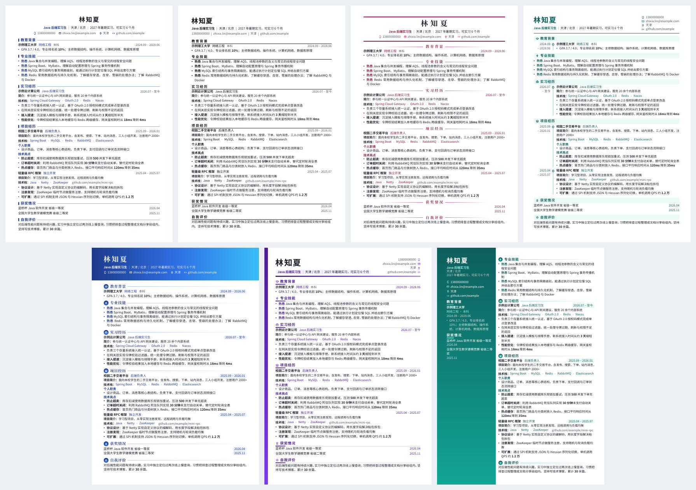

# 如页 Ruye

**开源、本地优先的中文技术简历编辑器。所见即导出：预览是什么样，导出的 PDF 就是什么样。**

[](https://github.com/a-xiaoyuan/ruye-resume/actions/workflows/ci.yml)
[](https://a-xiaoyuan.github.io/ruye-resume/)
[](LICENSE)


你只负责写内容，排版交给一个真正的排版引擎（[Typst](https://typst.app)）。
不登录就能用，没有会员、没有水印，默认简历不出你的浏览器；需要多台电脑同步时，可以自己部署一个可选的同步后端（Spring Boot）。

**在线使用：<https://a-xiaoyuan.github.io/ruye-resume/>**（纯静态页面，首次打开需要下载约 34MB 的排版引擎和字体，之后浏览器会缓存）


## 三句话认识如页

1. **预览与 PDF 同源。** 整个应用只有一个排版器——浏览器里的 Typst WASM。预览用它出 SVG，导出用它出 PDF，喂的是同一份输入、同一次排版结果。不用 html2canvas 截图，也没有「网页一套、打印一套」。
2. **「一页」是诚实的。** A4 智能一页会在可读性底线内自动收紧；**装不下就明确失败**，告诉你超出多少毫米、哪个模块最占地方，而不是悄悄把字缩成蚂蚁或多打一页。
3. **本地优先。** 简历默认只存在 localStorage，PDF 在本地生成，断网也能用。登录同步是可选的：本机始终是主副本，云端只是同步副本，两边同时改过时两份都保留，不会二选一丢掉。

## 三种页面模式

| 模式 | 是什么 | 适合 |
|---|---|---|
| **A4 智能一页** | 真正的 210×297mm 一页。超出时按「间距 → 紧凑版式 → 行距 → 字号」逐步收紧，装不下就报错并给出溢出报告；内容明显不满一页时，在上限内放宽间距与行距，让页面自然填满（字号不变） | 打印、投递 |
| **无损长一页** | A4 宽、高度随内容变化的**单页** PDF。不缩字号、不挤版面 | 屏幕投递（邮件、网申附件） |
| **标准分页** | 普通 A4 分页。多于一页时页脚印「1 / 2」，页数取自 Typst 实际分页，导出后再读 PDF 自身页数核对 | 打印 |

可读性底线：正文 ≥ 10.5pt，行距 ≥ 1.35，页边距 ≥ 12mm。
溢出报告来自真实排版——每个模块、条目占多高，是**把它拿掉重排一次量出来的**，不是按字数估算。预览里会直接画出 A4 底边和溢出区域。

## 七套模板 × 六种主题色

| 模板 | 风格 | 推荐场景 |
|---|---|---|
| `classic` 经典 · 简洁（默认） | 姓名居中、单一主色、细线标题，没有大面积色块；照片固定在右上角 | 绝大多数投递，打印与系统解析最稳妥 |
| `minimal` 极简 · 黑白 | 只用黑与深灰，无图标无色块，标题下一条黑线（主题色不生效） | 黑白打印、对格式要求保守的投递 |
| `elegant` 雅致 · 衬线 | 页眉上下双细线、宋体姓名居中，模块标题居中、两侧渐隐短线 | 国企、银行、研究岗 |
| `timeline` 时间轴 | 经历按时间轴排：左侧时间列、竖线与圆点，右侧内容；浅色标签条标题 | 经历多、时间线清晰 |
| `campus-serif` 校招 · 横幅 | 页顶通栏渐变横幅、白色姓名与联系方式，模块标题配渐变圆形图标，日期是浅色胶囊 | 应届生、实习 |
| `social-sans` 社招 · 侧条 | 纸张左缘渐变色条、大号姓名、联系方式竖排，信息更密，技能与履历优先 | 1～8 年经验 |
| `split-compact` 双栏 · 深色侧栏 | 左侧深色渐变侧栏（白字、技能胶囊），右侧经历；按实测高度自动平衡两栏 | 内容多、想压住一页 |

主题色：海蓝 / 青碧 / 胭脂 / 紫藤 / 琥珀 / 石墨，每个主题是一整套色板（深色主色、鲜明辅色、亮色、浅底），渐变和色块都从同一套色板取色。文字只用深色主色，打印对比度有保证。同一份内容随时换模板换色，不用重填。



## 编辑体验

- **三栏工作台**：左栏分「内容 / 模板与样式」两页——内容页是模块列表（图标、显隐、拖拽排序、一键添加），样式页是用真实排版生成的模板缩略图、主题色与页面模式；中间表单，右侧 A4 实时预览（可缩放）。排版在后台线程（Web Worker）里跑，长简历收紧时打字也不卡；连续修改时只排最新一版。
- **多份简历**：顶栏「我的简历」里切换、新建、复制、删除，可以给每份起备注名（如「投字节-后端」），为不同岗位各存一版。
- **十一种模块**：基本信息（含照片）、求职意向、教育、工作、实习、项目、技能、科研、论文、获奖、自我评价。要点里单独一行「个人职责：」会成为分块小标题，「防止超卖：……」会加粗句首短标题。模块可拖拽排序、显隐开关，也可一键按当前模板的推荐顺序排列。
- **专业技能两种写法**：「分类 ｜ 技能、技能」列技术栈，描述句写掌握深度（句首的「精通 / 熟悉 / 了解」自动加粗），可以只用一种，也可以混用。
- **为写简历设计的表单**：要点逐条编辑（回车新增、空行退格删除）、技术栈标签输入、日期自动归一化与「至今」、条目折叠、删除可撤销。
- **两种数据格式**：`.ruye.json` 与 Markdown **双向互转**（照片以内嵌图片保存在 Markdown 里，文件自包含），可以用 Git 管理你的简历，也可以粘贴给别的工具。
- **PDF 质量**：文字可选中、可搜索，链接可点击，中文字体内嵌，不是整页位图。
- **缺字检测**：内置字体是 GB2312 子集（3 个文件共 5.6MB，完整字体要 27.6MB），导出前会列出缺字，避免交付一份带方块的简历。
- **按岗位的示例**：「文件 → 从岗位示例新建」提供 Java 后端、Go 后端、前端、测试开发、算法、产品经理六份原创示例，各配一套合适的模板，内容按「职责 / 成果」分块、带量化结果。
- **写作建议**：编辑时在当前模块上方提示可以改进的地方——缺联系方式、整段经历没有一个数字、单条过长、只写了「负责 / 参与」、经历重复、「精通」用得太多。只是建议，不影响导出。
- **可选云同步**：配置了后端地址时，顶栏出现「登录同步」。登录后多份简历在后台自动同步（版本号乐观锁）；两台设备同时改过同一份时，云端版本另存为「冲突副本」；其他设备删除时本机保留，可在账号菜单里重新开启同步。支持退出所有设备、找回密码、注销账号。退出登录、注销账号都不删除本机内容。
- **导入安全**：链接只接受 http、https、mailto，预览前再清理一遍，打开别人发来的简历文件不会执行脚本。

## 和同类工具的取舍

| 维度 | 如页 Ruye | Reactive Resume | 木及简历 | 简单简历 |
|---|---|---|---|---|
| 定位 | 中文技术简历，本地优先 | 全功能简历平台 | Markdown 简历工具 | 表单 + AI 简历工具 |
| 开源 | MIT，全部代码 | MIT，可 Docker 自托管 | 编辑器核心开源 | 在线服务，未开源 |
| 账号 | 不需要 | 托管版需要；自托管不需要 | 需要（云端保存） | 需要 |
| 数据位置 | 只在本机浏览器 | 自托管数据库或官方云 | 远端存储 | 官方云 |
| 编辑方式 | 表单 + Markdown/JSON 互转 | 表单，多简历与求职追踪 | Markdown | 表单 + AI 改写 |
| 排版 | Typst WASM，预览与 PDF 同一排版器 | Web 渲染 | Web 渲染 | Web 渲染 |
| 一页策略 | 底线内收紧，装不下明确报错并量化溢出 | 自由分页 | 智能一页（官方宣传） | 以模板分页为主 |
| 导出 | PDF / Markdown / JSON，免费 | PDF / Word / Markdown / JSON | PDF / MD / PNG | 编辑分享免费，PDF 下载为会员功能 |

> 竞品信息来自各自官网与公开资料（2026-11），功能以其最新说明为准。如页不做账号、云同步、AI 改写、求职追踪——不是做不到，而是这些事会把「一份简历」变成「一份需要平台替你保管的数据」。如果你需要那些能力，上面的工具更值得选。

## 快速开始

需要 **Node.js ≥ 22.18**（直接运行 TypeScript 测试）与 **pnpm 10**。

```bash
pnpm install
pnpm fonts      # 首次：下载思源字体并生成子集（见 docs/fonts.md）
pnpm dev        # 启动编辑器，默认 http://localhost:5173
```

| 命令 | 作用 |
|---|---|
| `pnpm test` | 单元测试 + 真实 Typst 黄金测试（无字体时黄金测试自动跳过并说明原因） |
| `pnpm typecheck` | 对 packages 与 apps/web 做严格类型检查 |
| `pnpm smoke` | 用真实排版把三份样本按三种模式各导出一遍，输出 `out/*.pdf` 与 `out/report.md` |
| `pnpm build` | 构建静态站点到 `apps/web/dist`，可直接部署到 GitHub Pages 等任意静态托管 |

## 它是怎么工作的

```
一份文档（.ruye.json / Markdown）
   │  packages/schema     类型定义、零依赖校验器、Markdown 双向映射
   ▼
packages/engine           measure → fit-a4 / continuous / standard
   │                      产出 tokens + 页高 + 溢出报告
   │  packages/templates  Typst 模板 + default/floor 两套 token + 推荐模块顺序
   ▼
Typst WASM（浏览器内）──→ SVG → 右侧预览
                      └─→ PDF → 本地下载
```

关键点：**预览和导出共用同一次 layout 的结果**，所以不存在「预览一个样、导出另一个样」。
前端构建产物是纯静态文件，不依赖后端。`server/` 是可选的同步后端（Java 17 + Spring Boot 3 + Spring Security JWT + JPA，H2 / MySQL），详见 [server/README.md](server/README.md)。

```
apps/web/               Vite + React 18 编辑器（版式面板、模块导航、表单、预览）
packages/schema/        文档类型、零依赖校验、Markdown 互转、日期归一化
packages/engine/        排版引擎：measure / fit-a4 / continuous / 溢出报告 / Typst 后端
packages/templates/     七套 Typst 模板、common.typ、排版 token
server/                 可选的云同步后端（Spring Boot）：注册登录、简历同步 API
fixtures/               虚构示例：full（默认载入）/ 五个岗位示例 role-* / 排版测试样本 short / medium / long
e2e/                    Playwright 端到端测试
tests/                  单元测试与 Typst 黄金测试
docs/                   设计说明、字体说明、界面与模板截图、阶段报告
scripts/                字体下载与子集、smoke 导出
```

## 测试与 CI

- **单元与集成测试 114 项**（`pnpm test`）：schema 校验与 Markdown 互转、写作检查、文档操作、排版引擎、云同步三方合并与令牌自动刷新、导入解析、缩略图是否过期、Typst 真实黄金测试（七套模板 × 样本 × 模式）。
- **后端接口测试 18 项**（`cd server && mvn test`）：注册登录、刷新令牌轮换与重用检测、退出所有设备、找回密码、注销账号、IP 与邮箱限流、版本冲突、账号隔离、文档校验与限额、CORS、定时清理。
- **端到端测试**（Playwright，真实浏览器）：`pnpm e2e` 走编辑、换模板、导出 PDF、Markdown 往返、撤销、刷新后内容仍在、写作建议；先启动后端再运行 `pnpm e2e:sync`，用两个浏览器上下文模拟两台设备测同步。首次运行先 `pnpm exec playwright install chromium`；下载慢时可设置 `E2E_BROWSER_CHANNEL=chrome` 直接用本机 Chrome。
- **CI**：每次 push 到 `main` 自动执行前端 `install → typecheck → test → 准备字体 → test → build`，以及后端 `mvn test`（见 `.github/workflows/ci.yml`）。
- 黄金测试依赖真实字体与 WASM，本地没准备好时会自动跳过并打印原因，不会假装通过。

## 路线图

已完成：文档模型与校验、排版引擎与溢出报告、七套模板与六种主题色、要点小标题与自我评价、三栏编辑器、多份简历、Markdown/JSON 互转、本地自动保存、Web Worker 排版、GitHub Pages 在线 Demo、可选的账号与云同步后端。

计划中：缺字时按需加载完整字体、只读分享链接。

**明确不做**：强制登录、支付、会员、AI 改写、服务端渲染、自动删减你的内容。

## 字体与许可证

- 代码：**MIT**（见 [LICENSE](LICENSE)）
- 字体：思源黑体 / 思源宋体（Noto Sans SC / Noto Serif SC），**SIL Open Font License 1.1**。字体不进仓库，用 `pnpm fonts` 下载并裁成子集（需要 `pip install fonttools`），体积与缺字处理详见 [docs/fonts.md](docs/fonts.md)。

## 贡献

欢迎 Issue / PR。新模板请走「token + Typst 模板文件」的方式（见 `packages/templates`），不要引入后端。提交前请跑 `pnpm test` 与 `pnpm typecheck`。
